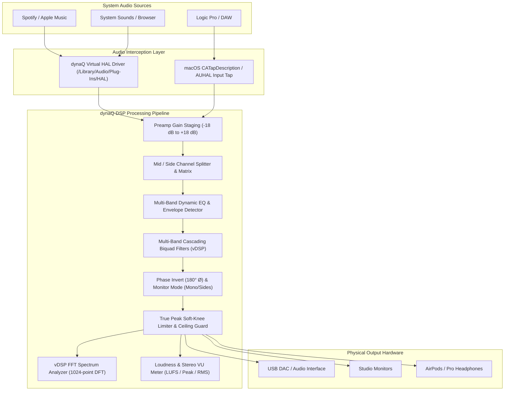

# dynaQ — Professional System-Wide Audio Management Suite

[](https://github.com/Gabe-Macri/dynaQ/actions/workflows/swift.yml)

**dynaQ** is a high-performance, ultra-low-latency audio management suite engineered for audio engineers, music producers, mastering studios, and audiophiles on macOS. Its flagship feature is a **system-wide, multi-band parametric and dynamic equalizer** that processes all system audio with studio-grade precision directly across CoreAudio hardware inputs and outputs.

---

## Pro Features & Audio Engineering Toolset

- **Decoupled Ultra-Lightweight Backend Architecture (`dynaQ-router`)**:
  - **Ultra-Lightweight Dedicated Backend**: CoreAudio routing logic runs completely decoupled from DSP equations, consuming ~0.0% CPU in passthrough.
  - **Explicit Client Stream Protocol**: The backend (`DynaQAudioDriver`) delegates audio blocks to registered clients (`AudioProcessingClient`).
  - **Client-Side Heavy Manipulation**: Heavy audio processing (multi-band parametric EQ, dynamic EQ, FFT analysis, true peak limiting, BS.1770 metering) runs strictly on the client side (`ClientDSPPipeline`).
  - **Standalone Backend Daemon**: `swift run dynaQ-router` runs the ultra-lightweight router as an independent background service.
- **High-Performance C & Vector DSP Backend (`CDspKernel`)**:
  - Critical real-time audio paths offloaded to an optimized C kernel (`CDspKernel`) with Apple `Accelerate` (vDSP) vectorization to completely relieve CPU stress from the Swift runtime.
  - **Lock-Free Atomic SPSC Ring Buffer**: `stdatomic.h` memory-fenced circular buffer eliminating mutexes, locks, and priority inversion from the real-time audio thread.
  - **Vectorized Biquad Cascade**: Cascading Direct Form II Transposed biquads executed in tight, unrolled C loops with smooth coefficient ramping.
  - **Hardware Vector Telemetry**: Peak and RMS evaluation powered by `vDSP_maxmgv` and `vDSP_measqv` for instantaneous, zero-allocation metering.
  - **Vectorized Mid/Side Matrix & Limiter**: Real-time M/S encoding/decoding and soft-knee true peak limiting executing via SIMD vector routines.
- **Real-Time System I/O Integration**:
  - Direct CoreAudio HAL hardware integration with selectable hardware inputs (mics, loopback devices, audio interfaces) and outputs (AirPods, Studio Monitors, USB DACs).
  - Variable hardware buffer frame size selection (**64, 128, 256, 512, 1024 samples**).
  - Accurate live **roundtrip latency reporting** (hardware latency + driver safety offset calculation in milliseconds, e.g. `< 3.0 ms`).
  - **Acoustic Feedback Protection**: Intelligent guard detecting built-in microphone and speaker combinations to prevent dangerous acoustic howl.
- **System-Wide Parametric EQ**:
  - Cascading Direct Form II Transposed biquad filters derived from Robert Bristow-Johnson (RBJ) Audio EQ Cookbook mathematics.
  - Filter shapes: **Bell (Peaking), Low Shelf, High Shelf, Low Pass (High Cut), High Pass (Low Cut), Notch, and Band Pass**.
  - Arbitrary band count with per-band frequency (20 Hz – 20 kHz), gain (±24 dB), and Q factor (0.1 – 18.0).
- **Mid / Side (M/S) & Stereo Channel Routing**:
  - Individual bands can be assigned to **Stereo**, **Mid (Center)**, **Side (Stereo Width)**, **Left**, or **Right** channels for surgical mastering and spatial balance.
  - **Phase Polarity Flip (180° Ø)** and monitor audition modes (**Stereo, Mono L+R, Sides L-R, Left Only, Right Only**).
- **Dynamic EQ (Real-time Envelope Tracking)**:
  - Frequency-selective compression/expansion with attack, release, threshold (-60 dBFS to 0 dBFS), dynamic range, and ratio controls.
- **A / B State Comparison**:
  - Dual profile comparison slots (**Slot A** vs **Slot B**) with instant toggle and `Copy A → B` workflow.
- **Real-Time FFT Spectrum Analyzer**:
  - Powered by Apple's `Accelerate` framework (`vDSP`).
  - 1024-point complex DFT with Hann windowing, mapped logarithmically to 64 visual frequency bins with peak ballistics.
- **Pro Metering & Clip Guard**:
  - ITU-R BS.1770 / EBU R128 compliant LUFS metering (momentary and integrated).
  - Stereo Peak and RMS meters with sticky clip LEDs.
  - Soft-knee **True Peak Limiter** with adjustable ceiling (-6.0 dBFS to 0.0 dBFS).
- **Per-Application Audio Routing**:
  - Route individual application streams (Spotify, Logic Pro, Ableton, Chrome, Zoom) through independent EQ profiles and custom volume trims.
- **Audiophile & Studio Presets**:
  - Harman Target Headphone Curve, Studio Reference Flat, Warm Analog Mastering, Vocal Clarity & De-Esser, Low-End Punch, Broadcast Speech.

---

## Architecture



## Getting Started

### 1. Build and Test
```bash
swift build
swift test
```

### 2. Inspect Hardware I/O & Latency
Enumerate all discovered CoreAudio inputs, outputs, sample rates, buffer sizes, and calculated hardware latencies:
```bash
swift run dynaQ --list-devices
```

### 3. Launch Studio GUI
```bash
swift run dynaQ
```
- Operates directly on live system audio input/output.
- The visualizer displays the real FFT spectrum of audio actively playing on the system.
- Select your target input and output hardware from the top navigation bar.
- Adjust buffer sizes on the fly to tune latency vs CPU overhead.
- Docks into the macOS Menu Bar for quick access.

---

## Documentation

Comprehensive technical documentation is available in the [`docs/`](docs/) directory:
- [System Overview & Architecture](docs/#/architecture)
- [C DSP Kernel & Lock-Free SPSC Buffer](docs/#/c-dsp-kernel)
- [Parametric & Dynamic EQ Mathematics](docs/#/dsp-engine)
- [CoreAudio Hardware Routing & Latency](docs/#/routing-and-io)
- [Standalone Router Daemon & CLI](docs/#/cli-and-router)
- [Installation & Build Pipelines](docs/#/installation)

---

## Production Release & Installation (v1.0.0-beta.1)

### Option A: Install via Homebrew (CLI & Background Service)
```bash
# Add dynaQ tap
brew tap Gabe-Macri/dynaq https://github.com/Gabe-Macri/dynaQ

# Install CLI binaries (dynaq and dynaq-router)
brew install dynaq

# Run audio router backend as a managed background service
brew services start dynaq

# Or install the graphical desktop app into /Applications
brew install --cask dynaq
```

### Option B: Run in Docker (DSP Diagnostics & Docs Server)
```bash
# Build lightweight container image (< 20 MB)
docker build -t dynaq .

# Execute real-time DSP cycle benchmarks
docker run --rm dynaq --bench

# Launch documentation server on http://localhost:8080
docker run -d -p 8080:8080 dynaq docs
```

### Option C: All-In-One Complete Installer (`.pkg` / `.dmg`) [Recommended]
For users who want the desktop app, virtual CoreAudio driver, and CLI commands installed automatically without manual configuration:
- Double-click `output/dynaQ-1.0.0-beta.1-all-in-one.dmg` and run **Install dynaQ Complete.pkg**.
- This automatically installs:
  - `dynaQ.app` into `/Applications`
  - `dynaq` and `dynaq-router` into `/usr/local/bin`
  - CoreAudio Virtual HAL Driver into `/Library/Audio/Plug-Ins/HAL`
  - Restarts CoreAudio automatically (no system reboot required).

### Option D: Minimal Drag-and-Drop Disk Image (`.dmg`)
Double-click `output/dynaQ-1.0.0-beta.1.dmg` and drag `dynaQ.app` into `/Applications`.

### Option E: Build Production Release Package from Source
Run the release packaging pipeline:
```bash
./scripts/build_release.sh
```
This automatically:
1. Compiles optimized production release binaries (`swift build -c release`).
2. Generates multi-resolution Retina `AppIcon.icns`.
3. Assembles the standalone macOS application bundle: `dist/dynaQ.app`.
4. Codesigns the bundle with ad-hoc signing (`codesign --deep`).
5. Packages a drag-and-drop installer disk image: `dist/dynaQ-1.0.0-beta.1.dmg`.

