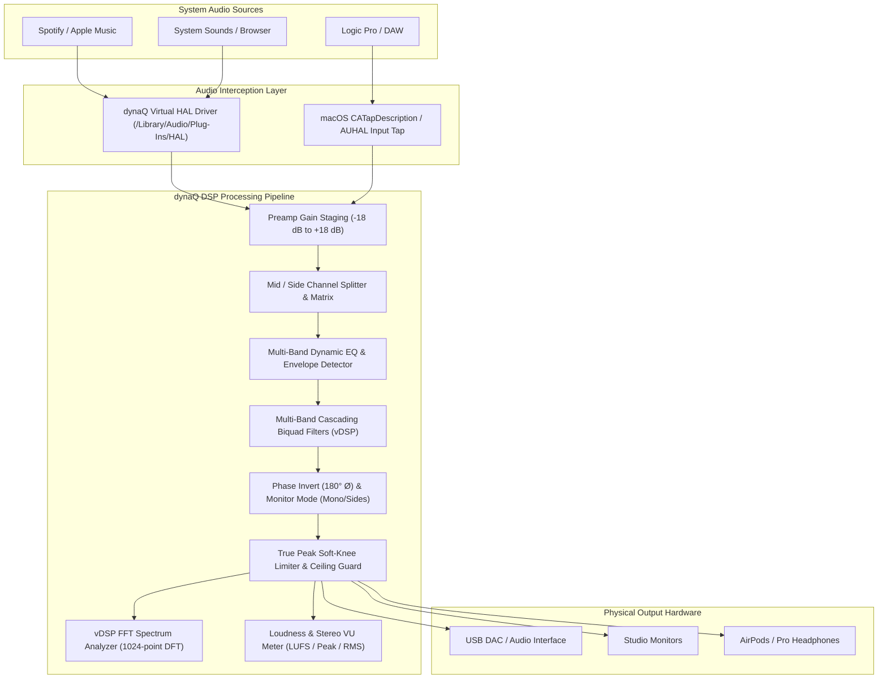

# dynaQ — Professional System-Wide Audio Management Suite

**dynaQ** is a high-performance, ultra-low-latency audio management suite engineered for audio engineers, music producers, mastering studios, and audiophiles on macOS. Its flagship feature is a **system-wide, multi-band parametric and dynamic equalizer** that processes all system audio with studio-grade precision directly across CoreAudio hardware inputs and outputs.

---

## 🎛 Pro Features & Audio Engineering Toolset

- **Real-Time System I/O Integration**:
  - Direct CoreAudio HAL hardware integration with selectable hardware inputs (mics, loopback devices, audio interfaces) and outputs (AirPods, Studio Monitors, USB DACs).
  - Variable hardware buffer frame size selection (**64, 128, 256, 512, 1024 samples**).
  - Accurate live **roundtrip latency reporting** (hardware latency + driver safety offset calculation in milliseconds, e.g. `< 3.0 ms`).
  - **Acoustic Feedback Protection**: Intelligent guard detecting built-in microphone and speaker combinations to prevent dangerous acoustic howl.
- **System-Wide Parametric EQ**:
  - Cascading Direct Form II Transposed biquad filters derived from Robert Bristow-Johnson (RBJ) Audio EQ Cookbook mathematics.
  - Filter shapes: **Bell (Peaking), Low Shelf, High Shelf, Low Pass (High Cut), High Pass (Low Cut), Notch, and Band Pass**.
  - Arbitrary band count with per-band frequency (20 Hz – 20 kHz), gain (±24 dB), and Q factor (0.1 – 18.0).
- **Mid / Side (M/S) & Stereo Channel Routing**:
  - Individual bands can be assigned to **Stereo**, **Mid (Center)**, **Side (Stereo Width)**, **Left**, or **Right** channels for surgical mastering and spatial balance.
  - **Phase Polarity Flip (180° Ø)** and monitor audition modes (**Stereo, Mono L+R, Sides L-R, Left Only, Right Only**).
- **Dynamic EQ (Real-time Envelope Tracking)**:
  - Frequency-selective compression/expansion with attack, release, threshold (-60 dBFS to 0 dBFS), dynamic range, and ratio controls.
- **A / B State Comparison**:
  - Dual profile comparison slots (**Slot A** vs **Slot B**) with instant toggle and `Copy A → B` workflow.
- **Real-Time FFT Spectrum Analyzer**:
  - Powered by Apple's `Accelerate` framework (`vDSP`).
  - 1024-point complex DFT with Hann windowing, mapped logarithmically to 64 visual frequency bins with peak ballistics.
- **Pro Metering & Clip Guard**:
  - ITU-R BS.1770 / EBU R128 compliant LUFS metering (momentary and integrated).
  - Stereo Peak and RMS meters with sticky clip LEDs.
  - Soft-knee **True Peak Limiter** with adjustable ceiling (-6.0 dBFS to 0.0 dBFS).
- **Per-Application Audio Routing**:
  - Route individual application streams (Spotify, Logic Pro, Ableton, Chrome, Zoom) through independent EQ profiles and custom volume trims.
- **Audiophile & Studio Presets**:
  - Harman Target Headphone Curve, Studio Reference Flat, Warm Analog Mastering, Vocal Clarity & De-Esser, Low-End Punch, Broadcast Speech.

---

## 🏗 Architecture



---

## 📁 Codebase Layout

```
dynaQ/
├── Package.swift                    # Swift Package Manager manifest (macOS 13.0+)
├── Sources/
│   ├── DynaQCore/                   # Core models, filter equations & preset management
│   │   ├── Models/
│   │   │   ├── FilterType.swift     # Filter shapes (Bell, Shelves, Cuts, Notch)
│   │   │   ├── EQBand.swift         # Band model with dynamic EQ & M/S routing
│   │   │   ├── EQProfile.swift      # Preset schema with phase invert & monitor modes
│   │   │   ├── AudioDevice.swift    # CoreAudio hardware metadata with latency/buffers
│   │   │   ├── AppAudioRoute.swift  # Per-application routing configuration
│   │   │   └── AudioMeter.swift     # Real-time LUFS/RMS/Peak telemetry
│   │   └── Presets/
│   │       ├── DefaultPresets.swift # Factory curves (Harman, Flat, Vocal, Mastering)
│   │       └── PresetStore.swift    # JSON persistence in ~/Library/Application Support
│   ├── DynaQDSP/                    # High-performance vectorized audio DSP
│   │   ├── Biquad/
│   │   │   ├── BiquadCoefficients.swift # RBJ formulas & analytical magnitude response
│   │   │   └── BiquadFilter.swift       # Direct Form II Transposed stereo filter
│   │   ├── EQ/
│   │   │   ├── ParametricEQEngine.swift # Multi-band cascading M/S filter processor
│   │   │   └── DynamicEQProcessor.swift # Envelope follower & dynamic delta gain
│   │   ├── Analysis/
│   │   │   ├── SpectrumAnalyzer.swift   # Accelerate vDSP FFT with Hann windowing
│   │   │   └── LoudnessMeter.swift      # ITU-R BS.1770 stereo meter & clipping logic
│   │   └── Dynamics/
│   │       └── TruePeakLimiter.swift    # Anti-clipping soft-knee peak limiter
│   ├── DynaQAudioDriver/            # CoreAudio HAL & audio graph management
│   │   ├── CoreAudio/
│   │   │   └── CoreAudioManager.swift   # Device enumeration, buffer size & latency
│   │   └── Engine/
│   │       ├── AudioEngineManager.swift # Real-time I/O AUHAL engine & AudioRingBuffer
│   │       └── AudioTapController.swift # HAL driver bridge & macOS process taps
│   ├── DynaQUI/                     # Dark Studio Pro UI (SwiftUI)
│   │   ├── Theme/
│   │   │   └── DynaQTheme.swift         # Dark studio palette, grid lines, accents
│   │   └── Views/
│   │       ├── EQCurveView.swift        # Octave markers, tooltips, live FFT spectrum
│   │       ├── EQBandInspectorView.swift# M/S routing, numeric readouts, dynamic EQ
│   │       ├── MasterSectionView.swift  # A/B slots, Ø Phase, Limiter, VU meters
│   │       ├── DeviceSelectorView.swift # Hardware In/Out, buffer size, latency badge
│   │       ├── PresetPickerView.swift   # Preset library drawer & custom saver
│   │       ├── AppRoutingView.swift     # Per-application routing panel
│   │       └── Components/
│   │           ├── RotaryKnob.swift     # Pro audio rotary knob with drag control
│   │           └── VUMeterView.swift    # Segmented stereo meter with clip LEDs
│   └── DynaQApp/                    # Application coordinator & entry point
│       ├── main.swift               # Dual GUI / CLI entry point & NSApplication delegate
│       ├── AppState.swift           # Centralized reactive coordinator & A/B manager
│       └── Views/
│           ├── MainWindowView.swift # Full studio desktop window
│           └── MenuBarView.swift    # Compact macOS menu bar status popup
├── Driver/                          # Virtual Audio HAL Driver
│   ├── AudioServerPlugin/
│   │   ├── DynaQDriver.c            # Virtual loopback audio driver source
│   │   └── Info.plist               # Driver bundle metadata
│   └── README.md                    # Driver installation & CATapDescription guide
├── Tests/
│   ├── DynaQDSPTests/               # DSP tests: Biquad math, phase inversion, FFT
│   └── DynaQCoreTests/              # Core tests: Serialization, presets, cloning
└── scripts/
    ├── build.sh                     # Release build & test runner
    ├── run.sh                       # Quick launch script
    └── install_driver.sh            # Virtual driver deployment script
```

---

## 🚀 Getting Started

### 1. Build and Test
```bash
swift build
swift test
```

### 2. Inspect Hardware I/O & Latency
Enumerate all discovered CoreAudio inputs, outputs, sample rates, buffer sizes, and calculated hardware latencies:
```bash
swift run dynaQ --list-devices
```

### 3. Launch Studio GUI
```bash
swift run dynaQ
```
- Operates directly on live system audio input/output.
- The visualizer displays the real FFT spectrum of audio actively playing on the system.
- Select your target input and output hardware from the top navigation bar.
- Adjust buffer sizes on the fly to tune latency vs CPU overhead.
- Docks into the macOS Menu Bar for quick access.
