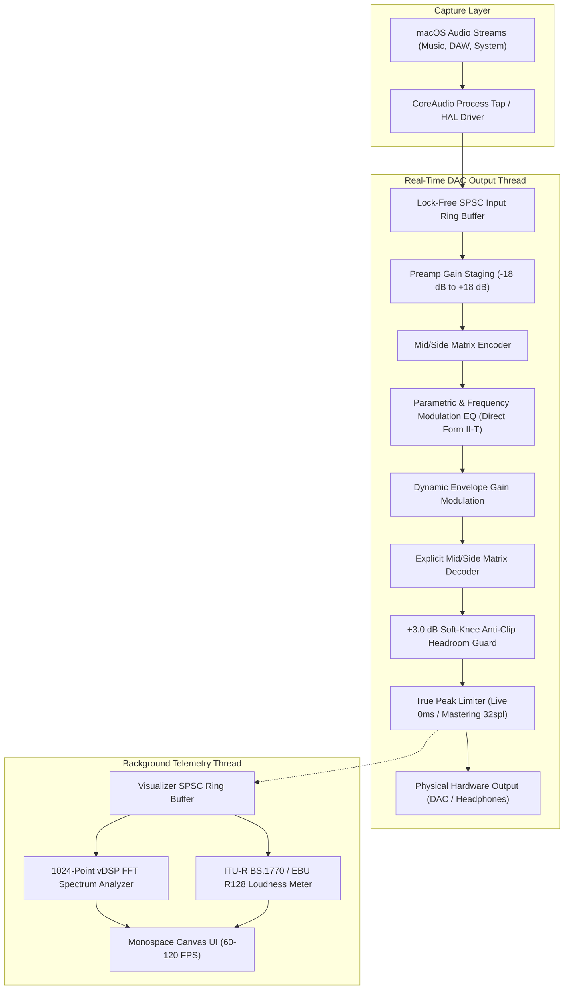

# dynaQ // Professional Audio Management Suite

[](https://github.com/Gabe-Macri/dynaQ/actions/workflows/swift.yml)

**dynaQ** is a high-performance system-wide audio equalization and routing suite for macOS. Engineered with a decoupled C/Rust/Swift architecture, it delivers studio-grade parametric equalization, dynamic frequency modulation, and true-peak brickwall limiting with zero-overhead real-time thread safety.

---

## Core Engineering Features

- **Decoupled Architecture (`DynaQAudioDriver` & `dynaQ-router`)**: CoreAudio routing runs decoupled from DSP computation (~0.0% CPU in passthrough). Client pipelines pull and push audio blocks via an explicit, non-blocking protocol.
- **Vectorized C DSP Kernel (`CDspKernel`)**: Time-critical signal maths offloaded to C99 with Apple Accelerate (vDSP) vectorization:
  - **Lock-Free Atomic SPSC Ring Buffer**: `stdatomic.h` memory-fenced circular buffers eliminating mutexes and priority inversions on real-time DAC threads.
  - **Cascading Biquads**: Direct Form II Transposed biquad sections with smooth coefficient ramping across block boundaries.
  - **Vectorized Mid/Side Matrix**: Real-time M/S encoding/decoding and dedicated pre-limiter matrix decode step.
  - **True Peak Brickwall Limiter**: Lookahead limiter with soft-knee saturation, featuring a **Zero-Latency Live Mode** (0 lookahead samples for DAW tracking) and **Mastering Mode** (32 samples).
- **Frequency Modulation (FM EQ)**:
  - Dynamic EQ with **Frequency Modulation** in addition to dynamic gain.
  - **Envelope Follower Mode (`.envelope`)**: Modulates center frequency based on signal transients.
  - **LFO Sweep Mode (`.lfo`)**: Periodic sinusoidal frequency modulation ($0.1$ to $20.0\text{ Hz}$, $\pm 3.0\text{ Oct}$ depth).
- **Dynamic Sample Rate & Auto-Routing**:
  - Automatically handles clock transitions (e.g. AirPods switching between 96 kHz and 48 kHz), purging stale ring buffer frames to prevent pitch warps.
  - Non-blocking auto-routing on startup via `kAudioHardwarePropertyProcessObjectList` listener.
- **Thread-Decoupled Visualizers & Telemetry**:
  - FFT spectrum analysis and ITU-R BS.1770 LUFS metering execute entirely on background telemetry threads via dedicated SPSC buffer.
  - Zero-allocation `Canvas` rendering for discrete RTA spectrum bars and 20-segment LED meters running at 60–120 FPS.
  - Internal $+3.0\text{ dB}$ anti-clip headroom buffer with rational soft-knee saturation guard ($\tanh$).
- **Rust SIMD Optimization Engine (`dynaq-rust`)**:
  - Sub-millisecond AutoEQ target curve optimization (scipy/SLSQP replacement reducing RMSE).
  - High-precision FIR filter kernel generation and 4x oversampled true-peak detection.
  - Accessible via CLI (`dynaq-opt`) and C dynamic library (`libdynaq_rust.dylib`).
- **Python Backend SDK & IPC Bridge (`python/dynaq`)**:
  - Python client and headless background server communicating via Unix domain socket (`/tmp/dynaq_ipc.sock`) or TCP port 9879.
  - Programmatic EQ profile switching, telemetry querying, and automated test integration.

---

## Signal Pipeline Architecture



---

## Technical Specifications

| Parameter | Specification |
| :--- | :--- |
| **Supported OS** | macOS 14.0+ (Sonoma, Sequoia) on Apple Silicon (arm64) and Intel (x86_64) |
| **Audio Subsystem** | CoreAudio HAL + AudioOutputUnit (AUHAL) + Process Tap (`CATapDescription`) |
| **Supported Sample Rates**| 44.1 kHz, 48.0 kHz, 88.2 kHz, 96.0 kHz, 192.0 kHz (with dynamic switch handling) |
| **Hardware Buffer Sizes** | 64, 128, 256, 512, 1024 samples |
| **Roundtrip Latency** | Direct measurement: $\sim 2.8\text{ ms}$ (at 64 samples / 48 kHz) |
| **DSP Precision** | 32-bit floating point SIMD (Apple Accelerate vDSP + C99 + Rust SIMD) |
| **EQ Topologies** | Bell (Peaking), Low Shelf, High Shelf, Low Pass, High Pass, Notch, Band Pass |
| **Modulation Modes** | Static EQ, Dynamic Gain Modulation, Frequency Modulation (Envelope & LFO) |
| **Metering & Limits** | True Peak, RMS, Momentary/Integrated LUFS, Soft-Knee Brickwall Ceiling |
| **IPC Protocol** | JSON-RPC over Unix domain socket (`/tmp/dynaq_ipc.sock`) and TCP port 9879 |

---

## Quick Start

### Build and Verify
```bash
# Build complete Swift workspace and run unit tests
swift build
swift test --parallel

# Run Rust SIMD unit tests
cargo test --manifest-path native/dynaq-rust/Cargo.toml

# Run Python SDK unit tests
python3 -m unittest discover -s python/tests
```

### Command-Line Diagnostics
```bash
# Enumerate hardware endpoints, sample rates, buffer sizes, and latencies
swift run dynaQ --list-devices

# Run headless routing backend daemon in ultra-lightweight passthrough
swift run dynaQ-router

# Run Rust AutoEQ optimization CLI
./dist/dynaq-opt --target harman --measured measurements.csv --output profile.json
```

---

## Installation & Deployment

### 1. Unified All-In-One Installer (Recommended)
Packages the graphical app, CoreAudio HAL virtual driver, Rust engine, Python SDK, and CLI tools:
- Mount `output/dynaQ-Installer.dmg` and run **Install dynaQ Complete.pkg**.
- Installs `dynaQ.app` to `/Applications`, CLI tools to `/usr/local/bin`, and restarts `coreaudiod` automatically.

### 2. Homebrew
```bash
brew tap Gabe-Macri/dynaq https://github.com/Gabe-Macri/dynaQ
brew install dynaq        # Installs CLI binaries
brew services start dynaq # Starts background routing daemon
brew install --cask dynaq # Installs /Applications/dynaQ.app
```

### 3. Docker Environment
```bash
docker build -t dynaq .
docker run --rm dynaq --bench           # Run DSP cycle benchmarks
docker run -d -p 8080:8080 dynaq docs   # Serve offline documentation at localhost:8080
```

### 4. Build Release from Source
```bash
./scripts/build_release.sh
```
Compiles universal binaries, signs packages, and generates clean DMGs and PKGs in `output/`.

---

## Documentation Index

Full technical documentation is available in [`docs/`](docs/) or via the offline web server:
- [Architecture & Threading Model](docs/architecture.md)
- [C DSP Kernel & Memory Barriers](docs/c-dsp-kernel.md)
- [EQ Mathematics & Frequency Modulation](docs/dsp-engine.md)
- [CoreAudio Routing & Latency](docs/routing-and-io.md)
- [Daemon, CLI, & Python Backend](docs/cli-and-router.md)
- [Installation & Build Pipelines](docs/installation.md)
