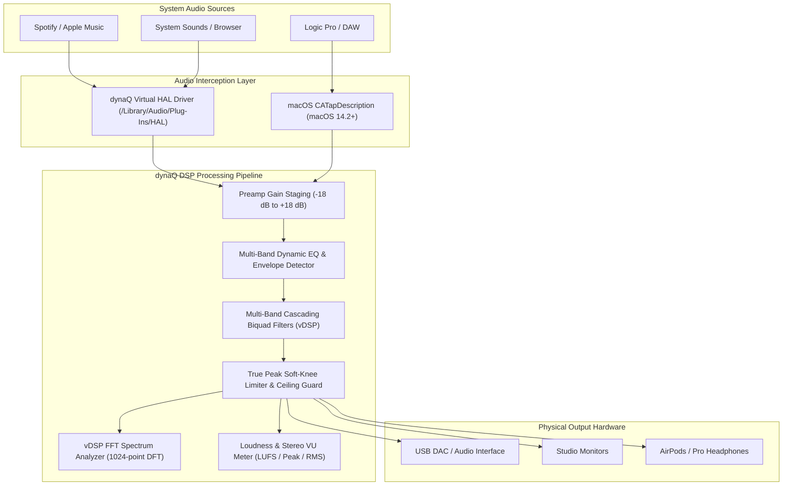

# dynaQ — Professional System-Wide Audio Management Suite

**dynaQ** is a high-performance, low-latency audio management suite engineered for audio professionals, producers, and audiophiles on macOS. Its flagship feature is a **system-wide, multi-band parametric and dynamic equalizer** that processes all system sound with studio precision before routing it to physical monitors, headphones, or external DACs.

---

## 🎛 Key Features

- **System-Wide Parametric EQ**:
  - Cascading Direct Form II Transposed biquad filters derived from Robert Bristow-Johnson (RBJ) Audio EQ Cookbook mathematics.
  - Supported filter shapes: **Bell (Peaking), Low Shelf, High Shelf, Low Pass (High Cut), High Pass (Low Cut), Notch, and Band Pass**.
  - Arbitrary band count with per-band frequency (20 Hz – 20 kHz), gain (±24 dB), and Q/bandwidth (0.1 – 18.0).
- **Dynamic EQ (Real-time Envelope Tracking)**:
  - Frequency-selective compression/expansion.
  - Attack, release, threshold (-60 dBFS to 0 dBFS), and ratio controls for dynamic de-essing, bass boom suppression, or transient expansion.
- **Real-Time FFT Spectrum Analyzer**:
  - Accelerated via Apple's `Accelerate` framework (`vDSP`).
  - Hann-windowed, 1024-point complex DFT mapped logarithmically across 64 visual frequency bands with smooth peak decay.
- **Interactive Pro Canvas GUI**:
  - Drag-and-drop EQ node handles (drag X for frequency, drag Y for gain, fine numeric controls).
  - Glowing neon composite frequency curve plotted with real-time analytical transfer function response.
  - Interactive multi-band inspector with filter shape icons, mute/solo toggles, and dynamic EQ sliders.
- **Pro Metering & Clip Guard**:
  - ITU-R BS.1770 / EBU R128 compliant LUFS metering (momentary and integrated).
  - Stereo Peak and RMS meters with sticky clip indicators.
  - Soft-knee **True Peak Limiter** with adjustable ceiling (-6.0 dBFS to 0.0 dBFS) to prevent digital overs and protect studio monitors.
- **Per-Application Audio Routing**:
  - Route individual application streams (Spotify, Logic Pro, Ableton, Chrome, Zoom) through independent EQ profiles and custom volume trims.
- **Factory Audiophile Presets**:
  - **Audiophile Harman Target Curve**: Standardized headphone target with tactile sub-bass boost and linear presence.
  - **Studio Reference Flat**: Baseline transparent monitoring.
  - **Mastering Warm & Open**: Pultec-inspired low-end saturation and high-shelf air.
  - **Vocal Clarity & Dynamic De-Esser**: Automatically squashes harsh sibilance above 6.5 kHz.
  - **Low-End Punch & Tight Sub**: 60 Hz kick punch with 250 Hz mud attenuation.
  - **Broadcast Voice (SM7B / Podcasting)**: Speech intelligibility curve with proximity rumble removal.
  - Custom preset creator and JSON preset library manager.

---

## 🏗 Architecture



---

## 📁 Codebase Layout

```
dynaQ/
├── Package.swift                    # Swift Package Manager manifest (macOS 13.0+)
├── Sources/
│   ├── DynaQCore/                   # Core models, filter equations & preset management
│   │   ├── Models/
│   │   │   ├── FilterType.swift     # Filter shapes (Bell, Shelves, Cuts, Notch)
│   │   │   ├── EQBand.swift         # Band model with dynamic EQ parameters
│   │   │   ├── EQProfile.swift      # Preset schema with gain staging & limiter
│   │   │   ├── AudioDevice.swift    # CoreAudio hardware/virtual device metadata
│   │   │   ├── AppAudioRoute.swift  # Per-application routing configuration
│   │   │   └── AudioMeter.swift     # Real-time LUFS/RMS/Peak telemetry
│   │   └── Presets/
│   │       ├── DefaultPresets.swift # Factory curves (Harman, Flat, Vocal, Mastering)
│   │       └── PresetStore.swift    # JSON persistence in ~/Library/Application Support
│   ├── DynaQDSP/                    # High-performance vectorized audio DSP
│   │   ├── Biquad/
│   │   │   ├── BiquadCoefficients.swift # RBJ Cookbook formulas & analytical response
│   │   │   └── BiquadFilter.swift       # Direct Form II Transposed stereo filter
│   │   ├── EQ/
│   │   │   ├── ParametricEQEngine.swift # Multi-band cascading filter processor
│   │   │   └── DynamicEQProcessor.swift # Envelope follower & dynamic delta gain
│   │   ├── Analysis/
│   │   │   ├── SpectrumAnalyzer.swift   # Accelerate vDSP FFT with Hann windowing
│   │   │   └── LoudnessMeter.swift      # ITU-R BS.1770 stereo meter & clipping logic
│   │   └── Dynamics/
│   │       └── TruePeakLimiter.swift    # Anti-clipping soft-knee peak limiter
│   ├── DynaQAudioDriver/            # CoreAudio HAL & audio graph management
│   │   ├── CoreAudio/
│   │   │   └── CoreAudioManager.swift   # Device enumeration & hot-plug listeners
│   │   └── Engine/
│   │       ├── AudioEngineManager.swift # Real-time AVAudioEngine pipeline
│   │       └── AudioTapController.swift # HAL driver bridge & macOS process taps
│   ├── DynaQUI/                     # Dark Studio Pro UI (SwiftUI)
│   │   ├── Theme/
│   │   │   └── DynaQTheme.swift         # Dark studio palette, grid lines, accents
│   │   └── Views/
│   │       ├── EQCurveView.swift        # Interactive canvas with spectrum & handles
│   │       ├── EQBandInspectorView.swift# Fine parameter & dynamic EQ inspector
│   │       ├── MasterSectionView.swift  # Gain knobs, limiter ceiling, stereo meters
│   │       ├── DeviceSelectorView.swift # Output hardware picker & sample rate
│   │       ├── PresetPickerView.swift   # Category preset drawer & custom saver
│   │       ├── AppRoutingView.swift     # Per-application routing panel
│   │       └── Components/
│   │           ├── RotaryKnob.swift     # Pro audio rotary knob with drag control
│   │           └── VUMeterView.swift    # Segmented stereo meter with clip LEDs
│   └── DynaQApp/                    # Application coordinator & entry point
│       ├── main.swift               # Dual GUI / CLI entry point & NSApplication delegate
│       ├── AppState.swift           # Centralized reactive coordinator
│       └── Views/
│           ├── MainWindowView.swift # Full studio desktop window
│           └── MenuBarView.swift    # Compact macOS menu bar status popup
├── Driver/                          # Virtual Audio HAL Driver
│   ├── AudioServerPlugin/
│   │   ├── DynaQDriver.c            # Virtual loopback audio driver source
│   │   └── Info.plist               # Driver bundle metadata
│   └── README.md                    # Driver installation & CATapDescription guide
├── Tests/
│   ├── DynaQDSPTests/               # DSP tests: Biquad math, stability, FFT
│   └── DynaQCoreTests/              # Core tests: Serialization, presets, cloning
└── scripts/
    ├── build.sh                     # Release build & test runner
    ├── run.sh                       # Quick launch script
    └── install_driver.sh            # Virtual driver deployment script
```

---

## 🚀 Getting Started

### Prerequisites
- macOS 13.0 or later (Tested on macOS Ventura, Sonoma, and Sequoia).
- Swift 5.9+ / Xcode 15+ toolchain.

### 1. Build the Project
```bash
swift build
```

### 2. Run the Unit Tests
```bash
swift test
```
Validates filter stability, magnitude responses at center frequencies, FFT accuracy, and preset serialization.

### 3. CLI Utilities
dynaQ includes built-in CLI diagnostic tools:

- **List All CoreAudio Devices**:
  ```bash
  swift run dynaQ --list-devices
  ```
- **Run DSP Benchmark (Filter + FFT + Limiter Performance)**:
  ```bash
  swift run dynaQ --test-dsp
  ```
- **Check Audio Driver Status**:
  ```bash
  swift run dynaQ --driver-status
  ```

### 4. Launch the Studio GUI
Run the native application:
```bash
swift run dynaQ
```
- Click **"TEST TONE"** in the top navigation bar to generate multi-harmonic test tones and observe real-time FFT spectrum analyzer response and interactive filter shaping immediately!
- The app docks seamlessly into the **macOS Menu Bar** (`waveform.circle.fill`), providing rapid access to output switching, bypass toggling, and preset selection without taking up screen real estate.

---

## 📜 License
MIT License. Created for professional audio engineering workflows.
